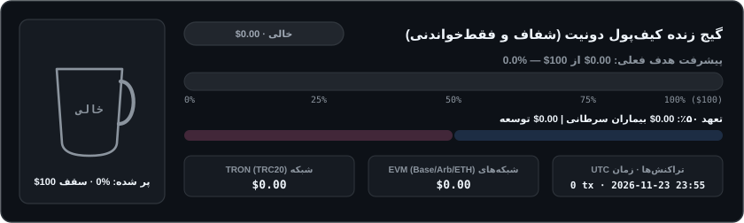

<div dir="rtl">

# 🧭 قطب‌نمای بنیان‌گذار برای ابسیدین (Obsi Founder Compass)

[English](README.md) | **فارسی**

[](https://github.com/h6s8n/obsi-founder-compass/actions/workflows/ci.yml)
[](LICENSE)

> **ایجنت Antigravity ایده‌های پراکنده و چندپروژه‌ای شما را به یک مسیر شفاف و قابل‌اجرا تبدیل می‌کند — روی Baseهای بومی ابسیدین، بدون پلاگین جانبی، ۱۰۰٪ لوکال و تحت Git.**

دو یا سه استارتاپ و پروژه را هم‌زمان پیش می‌برید، ولی وسط شلوغی کار، تسک‌ها گم می‌شوند و چت‌های هوش مصنوعی هم به‌جای پیدا کردن خریدار و شکاف بازار، دوباره برمی‌گردند سر رنگ دکمه و کدنویسی؟ **قطب‌نمای بنیان‌گذار** یک مسیر ۵لایه از استراتژی تا کار روزانه و ممیزی چت می‌سازد — و وسط کدنویسی عادی کاملاً ساکت می‌ماند.

---

## 🗺️ مسیر کار در یک نگاه

<p align="center">
<picture>
  <source media="(prefers-color-scheme: dark)" srcset="docs/assets/architecture-fa-dark.svg">
  <source media="(prefers-color-scheme: light)" srcset="docs/assets/architecture-fa-light.svg">
  
</picture>
</p>

---

## ✅ پیش‌نیازها (Requirements)

* **[Obsidian](https://obsidian.md)** — با قابلیت داخلی **Bases** (بدون نیاز به هیچ پلاگین جانبی)
* **Antigravity** — محیط IDE یا ابزار خط فرمان `agy`
* **Python 3.10+** — به‌همراه `pip install pyyaml`
* **Git** — برای ثبت خودکار تاریخچه یادداشت‌های والت

---

## 🚀 نصب با ۳ دستور

</div>

```bash
git clone https://github.com/h6s8n/obsi-founder-compass.git && cd obsi-founder-compass

# 1. Install the plugin globally into Antigravity
agy plugin install .

# 2. Reload Antigravity IDE, open ANY workspace, and type:
#    /obsi
```

<div dir="rtl">

**روی پروژه کاملاً جدید هم کار می‌کند؟** بله. چون پلاگین سراسری نصب می‌شود، در هر پوشه جدیدی که باز کنی `/obsi` فعال است. پروژه‌های قبلی اتوماتیک شناسایی می‌شوند و برای پوشه کاملاً جدید، همان منوی `/obsi` با یک کلیک از طریق لایه ۰ (`/obsi-setup`) به والت وصلش می‌کند.

---

## ⚡ دستورها در یک خط (وقتی می‌زنی چه می‌شود؟)

| دستور | وقتی صداش می‌زنی دقیقاً چه می‌شود؟ |
| :--- | :--- |
| **`/obsi`** | پروژه فعلی را می‌شناسد (یا اگر جدید است وصلش می‌کند) و منوی کلیکی هر ۵ لایه را بالا می‌آورد. |
| **`/obsi-setup`** | ۴ سوال ساده می‌پرسد، پیش‌نمایش می‌دهد (`--dry-run`) و والت ابسیدین با Base بومی (یا پروژه جدید) را می‌سازد. |
| **`/obsi-consult`** | اول هدف را در ۴ خط آینه می‌کند، کش ۹۰روزه را می‌خواند و بدون ورود به کد، شکاف بازار و مشتری را درمی‌آورد. |
| **`/obsi-priority`** | محورهای استراتژی را به کوهورت ۱۴روزه (`ادامه / چرخش / توقف`) و تسک‌های کوچک با گزینه‌های اختیاری حجم کار تبدیل می‌کند. |
| **`/obsi next` · `/obsi done`** | مهم‌ترین کار آزاد الان را نشان می‌دهد و با زدن `done` تسک بعدی قفل‌شده (`Locked`) را خودکار باز می‌کند. |
| **`/obsi-inspect`** | پیام‌های تازه چت را می‌خواند تا ادعای بدون منبع یا چاپلوسی را مچ بگیرد و سلامت والت را در ۱ ثانیه چک کند. |

---

## 💬 چطور کار می‌کند؟ (به زبان ساده)

**`/obsi-consult` چطور جلوی پرت‌شدن به سمت کد و باگ را می‌گیرد؟**
یک **فایروال کد** محکم دارد: وضعیت فنی فقط در یک خط خلاصه می‌شود تا کل تمرکز روی خریدار، رقیب، قیمت‌گذاری و اعتماد بماند. یافته‌های بازار هم با اعتبار ۹۰روزه کش می‌شوند تا سرچ تکراری انجام نشود.

**قرار است به من امر و نهی کند که «این پروژه را ببند و وقت نداری»؟**
ابداً. **لایه ۱** اصلاً در زمان و پروژه‌های دیگر شما دخالت نمی‌کند؛ فقط در **لایه ۲** (`/obsi-priority`) پیشنهادهای اختیاری برای چیدمان کوهورت می‌بینی و تصمیم نهایی همیشه با خودت است.

**وسط کدنویسی مزاحم می‌شود یا یادداشت‌هایم را جایی می‌فرستد؟**
نه. تمام نقش‌های مشاوره و ممیزی تا وقتی `/obsi*` نزنی کاملاً خاموش‌اند و کل داده‌ها به شکل Markdown محلی تحت Git روی سیستم خودت می‌ماند.

---

## 🤝 مشارکت در پروژه (اوپن‌سورس)

این مخزن عمومی و متن‌باز تحت لایسنس MIT است؛ از ایده‌ها، Issueها و PRهای شما استقبال می‌کنیم — به‌خصوص:
- **پلی‌بوک‌های بی‌نام‌شده بازارها و صنایع جدید** (`skills/obsi-consult/playbooks/`) با منبع و بنچمارک واقعی.
- **قالب‌ها و تقویم‌های محلی بیشتر** در `scaffold_brain.py`.
- **تست‌های جدید و باگ‌فیکس** در سیستم‌عامل‌ها و حالت‌های مختلف Obsidian Bases.

قبل از ارسال PR، با این دو دستور مطمئن شوید هیچ نشتی اطلاعاتی نیست و پلاگین معتبر است:

</div>

```bash
python -B -m unittest discover -s tests -v
agy plugin validate . --strict
```

<div dir="rtl">

---

## 📚 مطالعه عمیق‌تر

- 🧠 **[معماری ۵لایه چطور کار می‌کند](docs/fa/how-it-works.md)**: ساختار Baseها، فایروال کد، کش پلی‌بوک و بازشدن زنجیره‌ای تسک‌ها.
- 🧭 **[راهنمای دستورها، اسکریپت‌ها و تنظیمات](docs/fa/commands.md)**: همه اسلش‌کامندها و فایل `brain-os.json`.
- 🧪 **[تست‌ها و جلوگیری از نشت اطلاعات](docs/fa/verification.md)**: اجرای تست‌های E2E، ممیز والت و `agy plugin validate`.

---

<a id="donate"></a>

## ☕ حمایت از پروژه (Buy Me a Coffee)

[](https://tronscan.org/#/address/TZ6CDh5UXKKgq8CQbHW6VDxY3fnzQAABbo)

<picture>
  <source media="(prefers-color-scheme: dark)" srcset="https://raw.githubusercontent.com/h6s8n/obsi-founder-compass/badges/donation_meter_fa_dark.svg">
  <source media="(prefers-color-scheme: light)" srcset="https://raw.githubusercontent.com/h6s8n/obsi-founder-compass/badges/donation_meter_fa_light.svg">
  
</picture>

اگر این ساختار ۵لایه ابسیدین، فایروال استراتژی یا بازرس مچ‌گیر چت باعث شد بین پروژه‌هایتان گم نشوید و سریع‌تر به فروش واقعی برسید:

- ⭐ **ستاره دادن به مخزن (Star):** بهترین کمک برای دیده‌شدن جریان‌های کاری سبک و بدون پلاگین در جامعه سازنده‌هاست.
- 🤝 **مشارکت (PR):** ارسال Issue یا PR تحت [لایسنس MIT](LICENSE) همیشه باز است.
- ☕ **حمایت مالی / یک فنجان قهوه (واریز مستقیم و شفاف آن‌چین):**
  می‌توانید مستقیم از طریق آدرس‌های عمومی زیر حمایت کنید؛ تمام واریزی‌های ورودی به‌صورت خودکار توسط [.github/workflows/donation-tracker.yml](.github/workflows/donation-tracker.yml) خوانده شده و روی نمودار و بج بالا به‌روزرسانی می‌شوند:

| شبکه و ارزهای قابل واریز | آدرس عمومی کیف‌پول | اکسپلورر شفافیت |
| :--- | :--- | :--- |
| **TRON (`USDT TRC20` / `TRX`)** | `TZ6CDh5UXKKgq8CQbHW6VDxY3fnzQAABbo` | [مشاهده در Tronscan](https://tronscan.org/#/address/TZ6CDh5UXKKgq8CQbHW6VDxY3fnzQAABbo) |
| **شبکه‌های EVM (`USDC` / `USDT` / `ETH` — Base / Arbitrum / Ethereum)** | `0x0a4C4D067526AcFDb394469D1227754211b90c49` | [Basescan](https://basescan.org/address/0x0a4C4D067526AcFDb394469D1227754211b90c49) · [Etherscan](https://etherscan.io/address/0x0a4C4D067526AcFDb394469D1227754211b90c49) |

> **🎗️ تعهد ۵۰٪ خیریه:** **نیمی (۵۰٪) از کل مبالغ دریافتی از این حمایت‌ها** صرف کمک به **بیماران مبتلا به سرطان** خواهد شد. با توجه به عمومی بودن آدرس‌های کیف‌پول، تمام واریزی‌ها و سهم ۵۰٪ خیریه به‌شکل شفاف روی بلاک‌ین قابل پیگیری است.

</div>
