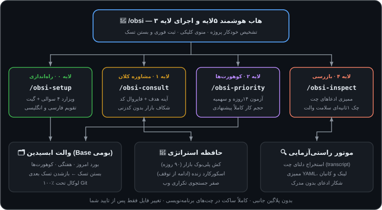

<div dir="rtl">

# 🧭 قطب‌نمای بنیان‌گذار برای ابسیدین (Obsi Founder Compass)

[English](README.md) | **فارسی**

[](https://github.com/h6s8n/obsi-founder-compass/actions/workflows/ci.yml)
[](LICENSE)

> **ایجنت Antigravity ایده‌های پراکنده و چندپروژه‌ای شما را به یک مسیر شفاف و قابل‌اجرا تبدیل می‌کند — روی Baseهای بومی ابسیدین، بدون پلاگین جانبی، ۱۰۰٪ لوکال و تحت Git.**

دو یا سه استارتاپ و پروژه را هم‌زمان پیش می‌برید، ولی وسط شلوغی کار، تسک‌ها گم می‌شوند و چت‌های هوش مصنوعی هم به‌جای پیدا کردن خریدار و شکاف بازار، دوباره برمی‌گردند سر رنگ دکمه و کدنویسی؟ **قطب‌نمای بنیان‌گذار ابسیدین** یک سیستم ۵لایه به شما می‌دهد: از آینه هدف و تحلیل کلان بازار تا کوهورت‌های ۱۴روزه، کارهای روزانه و بازرس ضد توهم — در حالی که وسط چت‌های عادی برنامه‌نویسی کاملاً ساکت می‌ماند.

---

## 🗺️ مسیر کار در یک نگاه

<p align="center">
<picture>
  <source media="(prefers-color-scheme: dark)" srcset="docs/assets/architecture-fa-dark.svg">
  <source media="(prefers-color-scheme: light)" srcset="docs/assets/architecture-fa-light.svg">
  
</picture>
</p>

---

## 🚀 نصب با ۳ دستور

</div>

```bash
git clone https://github.com/h6s8n/obsi-founder-compass.git && cd obsi-founder-compass

# 1. Install the plugin into Antigravity
agy plugin install .

# 2. Reload Antigravity IDE, open any project workspace, and type:
#    /obsi
```

<div dir="rtl">

همین. اگر هنوز والت ابسیدین نساخته‌اید، یک ویزارد ۴ سوالی بعد از پیش‌نمایش فایل‌ها (`--dry-run`) همه‌چیز را برایتان آماده می‌کند.

---

## 💬 چطور کار می‌کند؟ (به زبان ساده)

**چطور چند پروژه را بدون دردسر پلاگین‌های اضافی ابسیدین مرتب نگه دارد؟**
دستور `/obsi-setup` (یا اولین بار `/obsi`) را بزنید. با ۴ سوال کلیکی، یک والت تحت Git فقط با **Baseهای بومی ابسیدین** (`.base` + بورد اختصاصی هر پروژه) و تقویم دلخواه شما (`fa` شنبه–جمعه یا `en` دوشنبه–یکشنبه) ساخته می‌شود.

**`/obsi-consult` چطور جلوی پرت‌شدن مشاوره به سمت کد و باگ را می‌گیرد؟**
هر مشاوره با **آینه هدف (Vision Mirror Gate)** شروع می‌شود (۴ خط ساده که اول خودتان تایید می‌کنید) و یک **فایروال کد** محکم دارد: فقط درباره مشتری، رقبا، قیمت‌گذاری، تامین و اعتماد حرف می‌زند؛ نه اسم فایل‌های کد و پورت سرور. یافته‌های تاییدشده هم در `playbooks/` با اعتبار ۹۰روزه ذخیره می‌شوند تا سرچ تکراری انجام نشود.

**قرار است به من امر و نهی کند که «این پروژه را ببند و وقت نداری»؟**
ابداً. در **لایه ۱** (`/obsi-consult`) هر استارتاپ کاملاً مستقل و فقط از دید بازار بررسی می‌شود (**ممنوعیت دخالت در زمان شما**). فقط وقتی وارد **لایه ۲** (`/obsi-priority`) می‌شوید، گزینه‌های سبک/متوسط/عمیق به‌همراه کوهورت‌های ۱۴روزه (`ادامه / چرخش / توقف`) پیشنهاد می‌شود و تصمیم نهایی همیشه با شماست.

**در روزمره چه دستوری بزنم که یادم نرود؟**
فقط `/obsi` را بزنید. خودش می‌فهمد الان داخل پوشه کدام پروژه هستید و منوی کلیکی ۵ لایه را می‌آورد؛ یا مستقیم با `/obsi next` تسک بعدی بدون قفل را ببینید و با `/obsi done` کار را ببندید تا تسک بعدی اتوماتیک باز شود.

**از کجا مطمئن شوم هوش مصنوعی عدد یا ادعای الکی تحویلم نداده؟**
هر جای چت `/obsi-inspect` را صدا بزنید. فقط قدم‌های تازه از آخرین بازرسی را می‌خواند (`transcript.jsonl`)، منبع و URL ادعاها را چک می‌کند، چاپلوسی را لو می‌دهد و با `vault_audit.py` در ۱ ثانیه سلامت کل والت را ممیزی می‌کند.

**وسط کدنویسی مزاحم می‌شود یا یادداشت‌هایم را جایی می‌فرستد؟**
نه. تمام نقش‌های مشاور و بازرس تا وقتی دستور `/obsi*` را نزنید کاملاً خاموش‌اند و تمام یادداشت‌ها، اسکورکاردها و پلی‌بوک‌ها به‌صورت Markdown محلی روی سیستم خودتان می‌ماند.

---

## 📚 مطالعه عمیق‌تر

- 🧠 **[معماری ۵لایه چطور کار می‌کند](docs/fa/how-it-works.md)**: ساختار Baseها، فایروال کد، کش پلی‌بوک و بازشدن زنجیره‌ای تسک‌ها.
- 🧭 **[راهنمای دستورها، اسکریپت‌ها و تنظیمات](docs/fa/commands.md)**: همه اسلش‌کامندها و فایل `brain-os.json`.
- 🧪 **[تست‌ها و جلوگیری از نشت اطلاعات](docs/fa/verification.md)**: اجرای تست‌های E2E، ممیز والت و `agy plugin validate`.

---

<a id="donate"></a>

## ☕ حمایت از پروژه (Buy Me a Coffee)

[](https://tronscan.org/#/address/TZ6CDh5UXKKgq8CQbHW6VDxY3fnzQAABbo)

<picture>
  <source media="(prefers-color-scheme: dark)" srcset="https://raw.githubusercontent.com/h6s8n/antigravity-skill-compass/badges/donation_meter_fa_dark.svg">
  <source media="(prefers-color-scheme: light)" srcset="https://raw.githubusercontent.com/h6s8n/antigravity-skill-compass/badges/donation_meter_fa_light.svg">
  
</picture>

اگر این ساختار ۵لایه ابسیدین، فایروال استراتژی یا بازرس مچ‌گیر چت باعث شد بین پروژه‌هایتان گم نشوید و سریع‌تر به فروش واقعی برسید:

- ⭐ **ستاره دادن به مخزن (Star):** بهترین کمک برای دیده‌شدن جریان‌های کاری سبک و بدون پلاگین در میان سازنده‌ها و بنیان‌گذاران است.
- 🤝 **مشارکت (PR):** افزودن پلی‌بوک‌های بی‌نام‌شده بازارهای جدید، قالب‌های بومی‌شده و بهبود تست‌ها تحت [لایسنس MIT](LICENSE) با آغوش باز پذیرفته می‌شود.
- ☕ **حمایت مالی / یک فنجان قهوه (واریز مستقیم و شفاف آن‌چین):**
  می‌توانید مستقیم از طریق آدرس‌های عمومی زیر حمایت کنید؛ وضعیت واریزی‌ها روی نمودار زنده بالا قابل مشاهده است:

| شبکه و ارزهای قابل واریز | آدرس عمومی کیف‌پول | اکسپلورر شفافیت |
| :--- | :--- | :--- |
| **TRON (`USDT TRC20` / `TRX`)** | `TZ6CDh5UXKKgq8CQbHW6VDxY3fnzQAABbo` | [مشاهده در Tronscan](https://tronscan.org/#/address/TZ6CDh5UXKKgq8CQbHW6VDxY3fnzQAABbo) |
| **شبکه‌های EVM (`USDC` / `USDT` / `ETH` — Base / Arbitrum / Ethereum)** | `0x0a4C4D067526AcFDb394469D1227754211b90c49` | [Basescan](https://basescan.org/address/0x0a4C4D067526AcFDb394469D1227754211b90c49) · [Etherscan](https://etherscan.io/address/0x0a4C4D067526AcFDb394469D1227754211b90c49) |

> **🎗️ تعهد ۵۰٪ خیریه:** **نیمی (۵۰٪) از کل مبالغ دریافتی از این حمایت‌ها** صرف کمک به **بیماران مبتلا به سرطان** خواهد شد. با توجه به عمومی بودن آدرس‌های کیف‌پول، تمام واریزی‌ها و سهم ۵۰٪ خیریه به‌شکل شفاف روی بلاک‌چین قابل پیگیری است.

</div>
