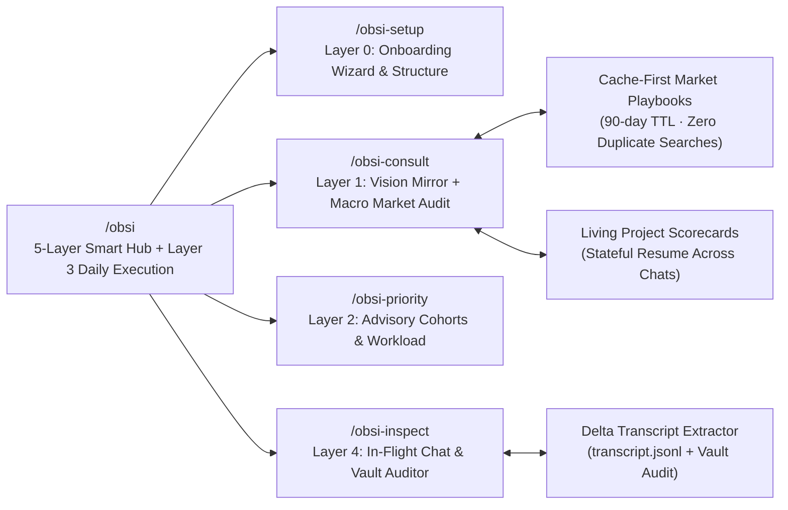

# Obsi Founder Compass

**The 5-Layer AI Operating System for Multi-Project Founders & Vibe-Coders on Native Obsidian Bases (Zero Community Plugins).**

Stop drowning in fragmented chats, forgotten tasks, and premature code tweaks. `obsi-founder-compass` pairs **Obsidian Native Bases** (`.base` kanbans & tables, zero third-party plugins) with **Antigravity workflow agents** to guide you from raw product vision to real market traction, time-boxed validation cohorts, and daily execution.

---

## Architecture: 5-Layer Hub-and-Spoke Command Palette



| Layer | Command | Purpose |
| :---: | :--- | :--- |
| **0** | `/obsi-setup` | Interactive 4-question onboarding wizard (`en` Mon–Sun or `fa` Sat–Fri) scaffolding a clean Git-tracked Native Obsidian Bases Vault; also adds new projects incrementally. |
| **1** | `/obsi-consult` | **30,000-ft Market Consultant** with Vision Mirror Gate, **No-Code Firewall**, **No Capacity Policing**, Cache-First Playbooks, and **Stateful Resume Scorecards**. |
| **2** | `/obsi-priority` | Turns approved **Macro Focus Bundles** into time-boxed **Cohorts** (`Scale / Pivot / Kill` gates) and atomic tasks with strictly **advisory** workload options. |
| **3** | `/obsi` | Thin 5-layer clickable hub (`ask_question`) + quick capture, next unlocked task, weekly slot planner, and `/obsi done` cascading unlock (`Locked` -> `Sprint`). |
| **4** | `/obsi-inspect` | Adversarial **In-Flight Inspector** reading delta chat turns (`transcript.jsonl`) to catch unverified assumptions + 1-second deterministic Vault integrity auditor (`vault_audit.py`). |

---

## Quick Start (60 Seconds)

### 1. Install Plugin
```bash
git clone https://github.com/<your-org>/obsi-founder-compass.git
agy plugin install ./obsi-founder-compass
```

### 2. Initialize Your Brain Vault
Open any workspace in Antigravity and type:
```text
/obsi
```
If no Vault is configured yet, the interactive wizard guides you through 4 clickable questions (Vault path, calendar language `en` or `fa`, life/work pillars, and your current projects), previews all files cleanly with `--dry-run`, creates the Vault + Git repo, and saves `~/.gemini/config/brain-os.json`.

---

## Why Founders & Vibe-Coders Love It
* **Zero Community Plugins Needed:** Built 100% on native Obsidian Bases (`.base` + inline project boards) and `{{date}}`/`{{title}}` templates.
* **No-Code Firewall in Strategy Mode:** Keeps `/obsi-consult` focused 100% on buyers, acquisition, differentiation, pricing, and trust — never drifting into code reviews.
* **Zero Duplicate Web Searches:** Distills verified industry benchmarks into versioned `playbooks/` (`90-day` TTL) with explicit `research_trace`.
* **Zero-Recall Clickable Menus:** Never memorize subcommands; `/obsi` and `/obsi-consult` detect your active workspace project and present clickable `ask_question` options.
* **Silent in Normal Coding Chat:** Consultation and audit roles stay completely dormant until explicitly invoked.

---

## Run Automated Verification Suite
```bash
python tests/test_oss_plugin_suite.py -v
agy plugin validate . --strict
```

## License
[MIT](./LICENSE)
