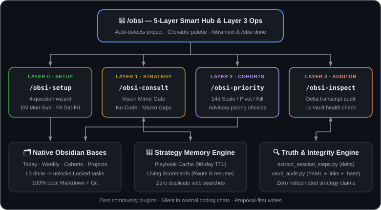
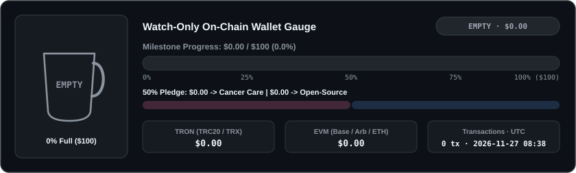

# 🧭 Obsi Founder Compass

**English** | [فارسی](README.fa.md)

[](https://github.com/h6s8n/obsi-founder-compass/actions/workflows/ci.yml)
[](LICENSE)

> **Your Antigravity agent turns messy founder ideas and multi-project chaos into one clear path — inside Native Obsidian Bases, zero third-party plugins, 100% local Markdown + Git.**

Building two or three startups while shipping features every night, only to wake up with scattered notes, stale tasks, and AI chats that drift back into CSS tweaks instead of finding your first paying buyers? **Obsi Founder Compass** gives you a 5-layer Hub-and-Spoke compass — from market gaps down to daily unlocked tasks and truth auditing — while staying completely silent during normal coding.

---

## 🗺️ How it flows

<p align="center">
<picture>
  <source media="(prefers-color-scheme: dark)" srcset="docs/assets/architecture-en-dark.svg">
  <source media="(prefers-color-scheme: light)" srcset="docs/assets/architecture-en-light.svg">
  
</picture>
</p>

---

## ✅ Requirements

* **[Obsidian](https://obsidian.md)** — with built-in **Bases** enabled (zero community plugins needed)
* **Antigravity** — IDE or `agy` CLI
* **Python 3.10+** — plus `pip install pyyaml`
* **Git** — tracks your local Vault history automatically

---

## 🚀 Install in 3 commands

```bash
git clone https://github.com/h6s8n/obsi-founder-compass.git && cd obsi-founder-compass

# 1. Install the plugin globally into Antigravity
agy plugin install .

# 2. Reload Antigravity IDE, open ANY workspace, and type:
#    /obsi
```

**Works in brand-new projects too:** Because the plugin installs globally, `/obsi` works in every folder you open. Registered Vault projects are detected automatically; if you open a brand-new folder, `/obsi` still launches cleanly and lets you link it to your Vault in one click via Layer 0 (`/obsi-setup`).

---

## ⚡ Commands in one line (what happens when you run them)

| Command | What happens when you type it |
| :--- | :--- |
| **`/obsi`** | Detects your current project, shows its top active tasks (up to 5 one-liners), and opens the 5-layer menu. |
| **`/obsi-setup`** | Asks 4 quick clickable questions, previews changes with `--dry-run`, and scaffolds your Obsidian Vault (or adds a new project). |
| **`/obsi-consult`** | Mirrors your product vision in 4 plain lines, checks cached 90-day playbooks, and finds market/buyer gaps without touching code. |
| **`/obsi-priority`** | Turns approved strategy bundles into 14-day `Scale / Pivot / Kill` experiments and atomic tasks with optional Light/Medium/Deep pacing. |
| **`/obsi next` · `/obsi log` · `/obsi done`** | Shows your top unlocked task, logs partial progress cleanly (`Doing`), or marks done and auto-unlocks the next `Locked` task. |
| **`/obsi-inspect`** | Reads recent chat turns to flag unverified AI claims or blind agreement, and runs a 1-second Vault health audit. |

---

## 💬 How does it work? (plain words)

**How does `/obsi-consult` stop AI from drifting into code tweaks?**
It enforces a strict **No-Code Firewall**: your built product is summarized in one line, so strategy sessions look purely at buyers, competitors, pricing, and trust. Verified findings are cached in `playbooks/` (`90-day` TTL) so you never pay for duplicate web searches.

**Will it lecture me to kill projects or manage my calendar?**
No. **Layer 1** (`/obsi-consult`) evaluates each project strictly on its own market merits (**No Capacity Policing**). Only in **Layer 2** (`/obsi-priority`) do you see neutral pacing options alongside 14-day Cohorts — you always choose.

**Does it interrupt regular coding chats or update Obsidian automatically?**
No interruptions — all strategy and audit rules stay completely dormant until you type an `/obsi*` command. Every confirmed write updates the exact local Markdown files inside your Vault, so **Obsidian boards (`.base`) update live automatically**.

---

## 🤝 Open-Source & Contributing

This repository is MIT-licensed and built for community collaboration. Contributions are warmly welcomed — especially:
- **Anonymized Market Playbooks** (`skills/obsi-consult/playbooks/`) with verified benchmarks and URLs.
- **Calendar / Language Templates** inside `scaffold_brain.py`.
- **Unit & Integrity Tests** or bug fixes across OS/Obsidian Bases edge cases.

Before opening a Pull Request, verify zero personal leakage and strict plugin validity locally:

```bash
python -B -m unittest discover -s tests -v
agy plugin validate . --strict
```

---

## 📚 Go deeper

- 🧠 **[How the 5-layer system works](docs/how-it-works.md)** — Native Bases schema, No-Code Firewall, Playbook Cache, and auto-unlocks.
- 🧭 **[Commands, CLI scripts & config](docs/commands.md)** — Full command options and `~/.gemini/config/brain-os.json`.
- 🧪 **[Testing & zero-leakage checks](docs/verification.md)** — E2E scaffolding suite, Vault auditor, and hygiene rules.

---

<a id="donate"></a>

## ☕ Buy Me a Coffee (On-Chain Support)

[](https://tronscan.org/#/address/TZ6CDh5UXKKgq8CQbHW6VDxY3fnzQAABbo)

<picture>
  <source media="(prefers-color-scheme: dark)" srcset="https://raw.githubusercontent.com/h6s8n/obsi-founder-compass/badges/donation_meter_dark.svg">
  <source media="(prefers-color-scheme: light)" srcset="https://raw.githubusercontent.com/h6s8n/obsi-founder-compass/badges/donation_meter_light.svg">
  
</picture>

If this 5-layer Obsidian Vault architecture, the No-Code Strategy Firewall, or the in-flight transcript inspector helped you stop context-switching and ship real traction faster:

- ⭐ **Star this repository** to help fellow indie founders and vibe-coders find plugin-free workflows.
- 🤝 **Contribute:** Open an Issue or PR under the [MIT License](LICENSE).
- ☕ **Buy me a coffee (Direct On-Chain Transfers):**
  Support the project instantly with low-fee direct transfers to the public watch-only addresses below. Every incoming transfer is tracked automatically and updated on the live meter above by [.github/workflows/donation-tracker.yml](.github/workflows/donation-tracker.yml):

| Network / Accepted Assets | Public Wallet Address | Explorer |
| :--- | :--- | :--- |
| **TRON (`USDT TRC20`, `TRX`)** | `TZ6CDh5UXKKgq8CQbHW6VDxY3fnzQAABbo` | [View on Tronscan](https://tronscan.org/#/address/TZ6CDh5UXKKgq8CQbHW6VDxY3fnzQAABbo) |
| **EVM (`USDC`, `USDT`, `ETH` — Base / Arbitrum / Ethereum)** | `0x0a4C4D067526AcFDb394469D1227754211b90c49` | [Basescan](https://basescan.org/address/0x0a4C4D067526AcFDb394469D1227754211b90c49) · [Etherscan](https://etherscan.io/address/0x0a4C4D067526AcFDb394469D1227754211b90c49) |

> **🎗️ 50% Charity Pledge:** **50% of all received donations** will be donated to support **cancer patients**. Because every deposit lands on public on-chain addresses, the total amount raised and its 50% charity allocation remain openly verifiable at any time.
